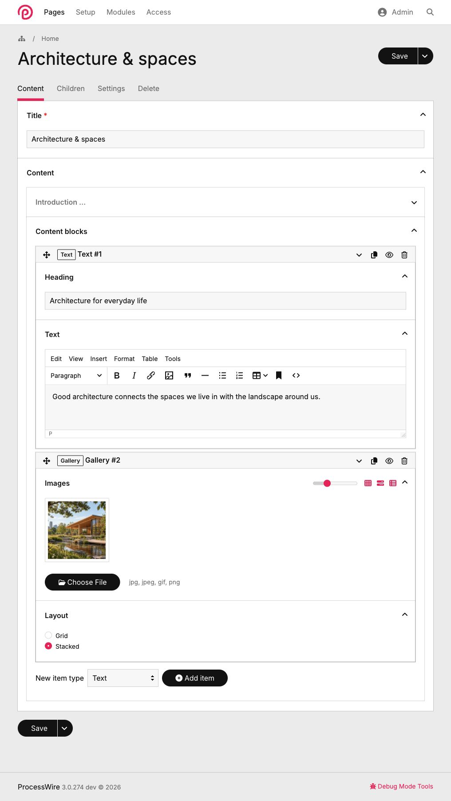

# FieldtypeFlex

**Structured content in one ProcessWire field.**

FieldtypeFlex is an open-source fieldtype for [ProcessWire](https://processwire.com/) that combines JSON storage, native Inputfields, ProcessWire selectors, File/Image support and typed repeatable content.

Define your field structure in PHP or JSON, edit everything together in Page Edit, and work with individual properties through the familiar ProcessWire API.

**Status:** 0.3.0 pre-release · **License:** MIT



## Features

- **One field, one JSON value.** Store related properties together without creating a separate ProcessWire field for every value.
- **ProcessWire selectors.** Query individual properties, typed rows and collection counts with `$pages->find()`.
- **Files and images.** Manage media directly in Flex and use ProcessWire-compatible `Pagefile` and `Pageimage` objects, including image resizing, variations and [per-file custom metadata](API.md#per-file-custom-fields).
- **Typed, nested rows.** Build sortable content blocks with different schemas, similar in concept to RepeaterMatrix. Nest row collections to create more complex structures.

Flex uses native ProcessWire Inputfields for editing, including validation, conditional dependencies, Page references, TinyMCE and multilingual text. Flex fields can also be used inside native ProcessWire Repeater items.

Native `showIf`/`requiredIf` conditions can reference local properties, `parent.`
and `root.` Flex properties, the owning `page.` inputs and the main editor's
`forpage.` inputs. See [dependency contexts](API.md#dependency-contexts).

## Installation

Requires **ProcessWire 3.0.259+**, **PHP 8.1+**, **MySQL 8.0+ or MariaDB 10.11+**, and **InnoDB**.

Place the module in `/site/modules/FieldtypeFlex/`, then go to **Modules → Refresh** in ProcessWire Admin and install **FieldtypeFlex**.

Native CLI maintenance commands are available on supported ProcessWire versions; PHP and Admin maintenance remain available on older cores.

## Quick start

Create a Flex field named `content` and add it to a page template. The example uses the installed `TextformatterEntities` module to escape plain text for HTML output.

Create `site/templates/flex-fields/content.php`:

```php
<?php namespace ProcessWire;

return [
    'heading' => [
        'type'           => 'text',
        'label'          => __('Heading'),
        'textformatters' => ['TextformatterEntities'],
    ],
    'hero' => [
        'type'           => 'image',
        'textformatters' => ['TextformatterEntities'],
        'label'          => __('Hero image'),
        'maxFiles'       => 1,
    ],
    'downloads' => [
        'type'           => 'file',
        'textformatters' => ['TextformatterEntities'],
        'label'          => __('Downloads'),
        'extensions'     => 'pdf txt zip',
        'maxFiles'       => 5,
    ],
    'blocks' => [
        'type'        => 'rows',
        'label'       => __('Content blocks'),
        'addRowLabel' => __('Add block'),
        'types'       => [
            'text' => [
                'label'    => __('Text'),
                'rowTitle' => '{heading}',
                'children' => [
                    'heading' => [
                        'type'           => 'text',
                        'label'          => __('Heading'),
                        'textformatters' => ['TextformatterEntities'],
                    ],
                    'body' => [
                        'type'         => 'TinyMCE',
                        'inheritField' => 'body', // Existing ProcessWire field using TinyMCE
                        'label'        => __('Body'),
                    ],
                ],
            ],
            'image' => [
                'label'    => __('Image'),
                'rowTitle' => '{caption}',
                'children' => [
                    'photo' => [
                        'type'           => 'image',
                        'textformatters' => ['TextformatterEntities'],
                        'maxFiles'       => 1,
                    ],
                    'caption' => [
                        'type'           => 'text',
                        'textformatters' => ['TextformatterEntities'],
                    ],
                ],
            ],
        ],
    ],
];
```

This creates one field with a heading, a hero image, file downloads and two types of content blocks: **Text** and **Image**.

Editors can add, duplicate, reorder and remove blocks directly in Page Edit. Each row has a stable identity and retains its own type.

### Render the content

Access Flex properties directly in a ProcessWire template:

```php
<?php namespace ProcessWire; ?>

<article>
    <h1><?= $page->content->heading ?></h1>

    <?php if($image = $page->content->hero): ?>
        size(1200, 700)->url ?>"
            alt="<?= $image->description ?>"
        >
    <?php endif; ?>

    <?php foreach($page->content->blocks as $block): ?>

        <?php if($block->rowType() === 'text'): ?>
            <section>
                <h2><?= $block->heading ?></h2>
                <?= $block->body ?>
            </section>

        <?php elseif($block->rowType() === 'image'): ?>
            <?php if($image = $block->photo): ?>
                <figure>
                    url ?>" alt="<?= $image->description ?>">

                    <?php if($block->caption): ?>
                        <figcaption>
                            <?= $block->caption ?>
                        </figcaption>
                    <?php endif; ?>
                </figure>
            <?php endif; ?>
        <?php endif; ?>

    <?php endforeach; ?>

    <?php if(count($page->content->downloads)): ?>
        <h2>Downloads</h2>
        <ul>
            <?php foreach($page->content->downloads as $file): ?>
                <li>
                    <a href="<?= $file->url ?>">
                        <?= $file->name ?>
                    </a>
                </li>
            <?php endforeach; ?>
        </ul>
    <?php endif; ?>
</article>
```

Flex follows the Page's output-formatting state. Plain text is **not HTML-encoded automatically**; configure `TextformatterEntities` for text rendered in HTML or escape it in the template. Explicit or inherited [native Textformatters](API.md#textformatters) control text output, while TinyMCE content retains its HTML markup. File/Image descriptions use their explicitly configured or inherited formatter list; without one they remain unescaped. The examples select `TextformatterEntities` explicitly. Choice values are raw keys, except Toggle can opt into native `formatType` output modes; label helpers encode display labels when formatted.

### Query with ProcessWire selectors

Flex properties are searchable through ProcessWire's selector API:

```php
// Match a regular property
$pages->find('content.heading*=Welcome');

// Match a property inside a specific row type
$pages->find('content.blocks.text.heading*=Introduction');

// Find pages containing image blocks
$pages->find('content.blocks._type=image');

// Find pages with at least three blocks
$pages->find('content.blocks.count>=3');

// Both conditions must match the same text row
$pages->find('@content.blocks.text.heading=Introduction, @content.blocks.text.body*=ProcessWire');
```

You can also work directly with specific row types:

```php
// Existing image rows, in their current order
$images = $page->content->blocks->rowsOfType('image');

// Search already loaded rows, retaining their order and identity
$matchingImages = $page->content->blocks->find('_type=image');
$galleries = $page->content->blocks->find('_type=image, photo.count>=3');

// Number of text rows
$count = $page->content->blocks->countOfType('text');
```

`FlexRows::find()` returns Rows from a loaded Page, including unsaved values;
`$pages->find()` returns Pages matching saved database values. Flex uses `_type`
for Row metadata in selectors, preserving `type` as a normal content property.
See [loaded collection search](API.md#searching-a-loaded-collection) for formatting,
visibility and differences from Repeater Matrix, and
[same-row selectors](API.md#operators-and-matching-semantics) for native Core limits.

Root Page-reference properties can also query supported native fields on referenced pages. See [Page-reference traversal](API.md#root-page-reference-traversal) for details.

See [API.md](API.md#selectors) for supported operators, same-row conditions and nested selectors.

## Nested rows

A `rows` collection can contain other `rows` collections. Each collection defines its own named row types and child properties.

For example, sections can contain content blocks, and individual blocks can contain further collections.

There is no fixed two-level nesting limit. The effective depth depends on database JSON limits and configurable resource budgets.

Optional `rowLazyLoad => true` defers closed simple Row bodies until opening.
Rich text, media and other specialized inputs retain direct rendering; nested
collections can opt in for their simple children. See the
[lazy loading contract](API.md#optional-lazy-row-bodies).

See the [typed and nested Rows example](examples/08-rows.php) and [API reference](API.md#nested-repeatables-and-resource-limits).

## More examples

The [configuration reference catalog](examples/README.md) starts with identical
JSON, PHP-array and InputfieldWrapper definitions, followed by focused native
Inputfield examples, typed/nested Rows and a composable Kitchen Sink.

- [Basic JSON](examples/01-basic.json) and [basic PHP](examples/02-basic.php)
- [Basic InputfieldWrapper](examples/02-basic-objects.php) — native Inputfield objects
- [Text and formatting](examples/03-text.php), [numbers and dates](examples/04-numbers-dates.php), [choices](examples/05-choices.php)
- [Page references and media](examples/06-references-media.php)
- [Advanced settings](examples/07-advanced.php) and [typed/nested Rows](examples/08-rows.php)
- [Kitchen Sink](examples/09-kitchen-sink.php) — composes schemas at the root and inside Rows

For the complete definition syntax, value types, settings and runtime methods, see **[API.md](API.md)**.

## Data preservation and maintenance

FieldtypeFlex preserves unknown stored properties during normal saves. Use `renamedFrom` to evolve property names and the superuser maintenance tools to review bulk renames or explicitly remove obsolete properties. Maintenance operations provide previews and conflict protection.

See the [Maintenance APIs](API.md#maintenance-apis) for Admin, PHP and optional CLI commands, batch handling and safety details.

## Current limitations

FieldtypeFlex is a pre-release. Some ProcessWire features and integrations are not supported:

- SQLite and PostgreSQL databases.
- Native ProcessWire page-version save/restore.
- Page-reference selector traversal from typed rows, across multiple hops, or into unsupported target fields.
- Certain media options, including overwrite mode and custom metadata templates. TinyMCE drag-and-drop uploads require a regular ProcessWire Image field as their destination.

See [API.md](API.md) for the complete supported contract.

## Development

The repository includes a disposable DDEV environment for development and integration testing.

```sh
bash scripts/setup.sh
ddev flex-test
ddev composer lint
```

See [CONTRIBUTING.md](CONTRIBUTING.md) and [docs/development.md](docs/development.md) for development instructions.

## License

FieldtypeFlex is released under the [MIT License](LICENSE).
